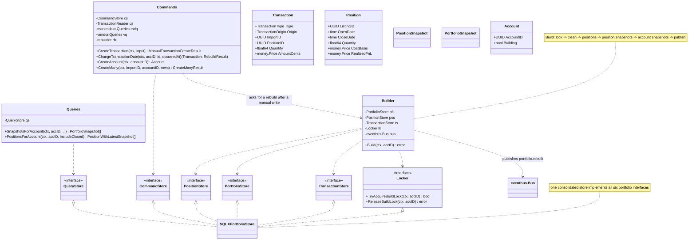
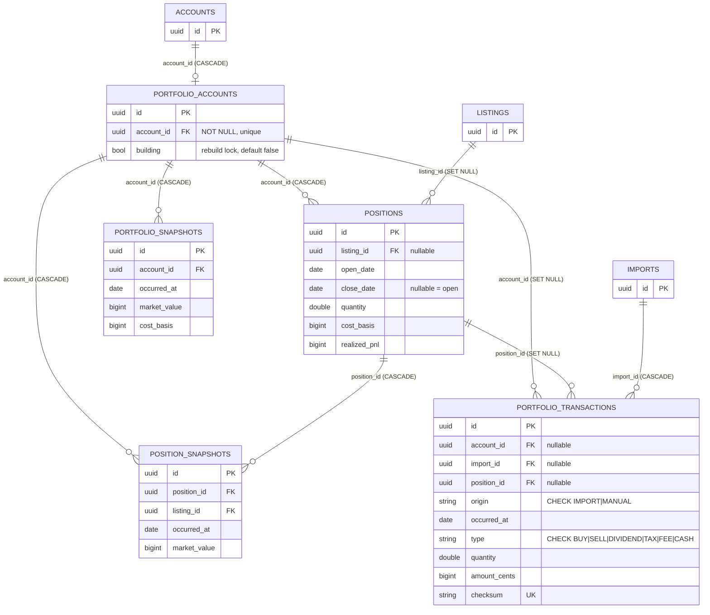
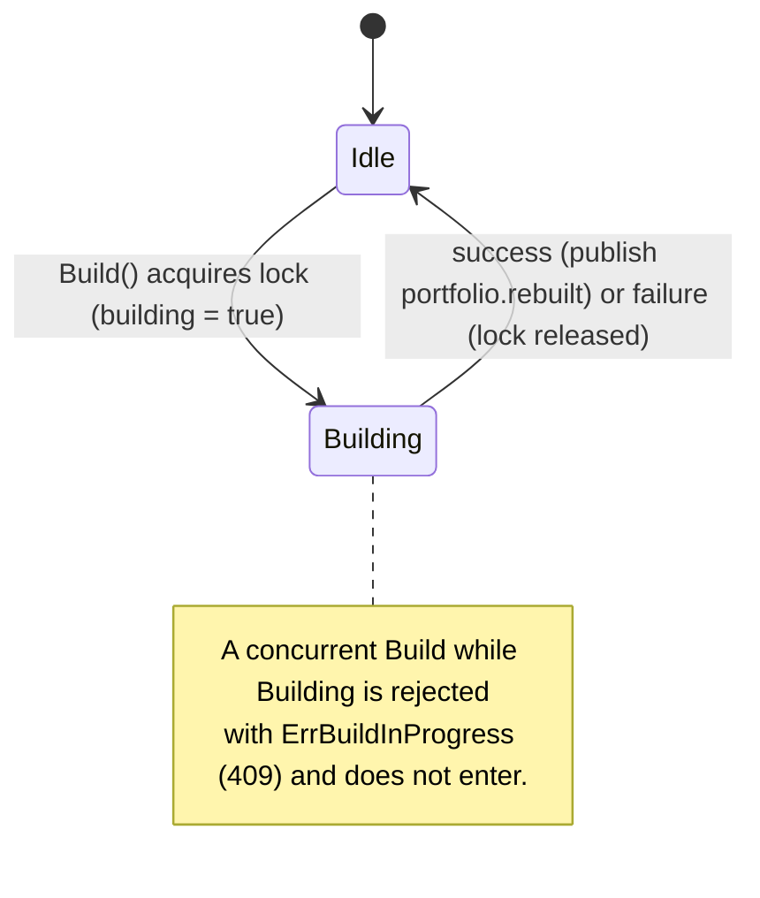
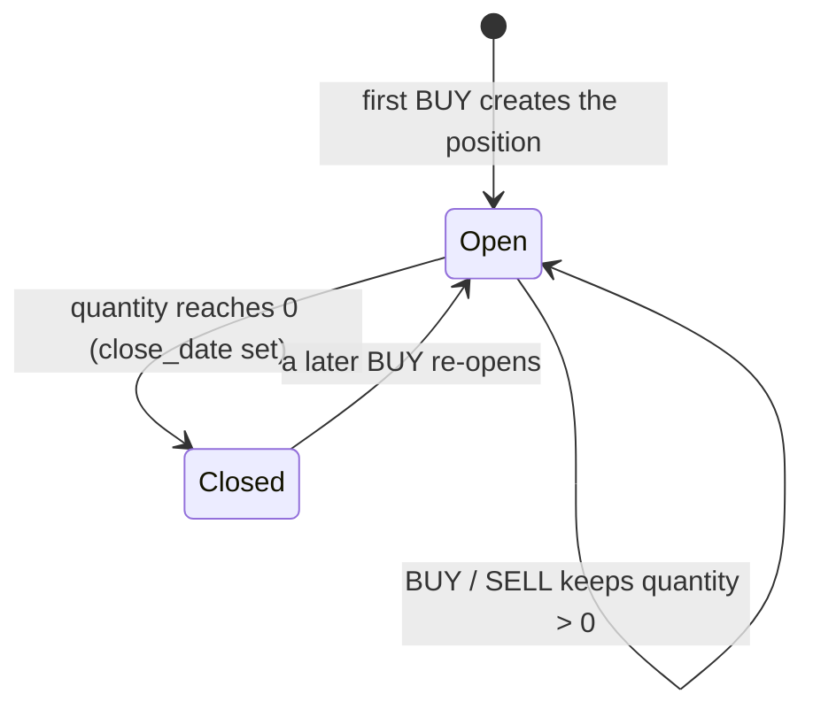
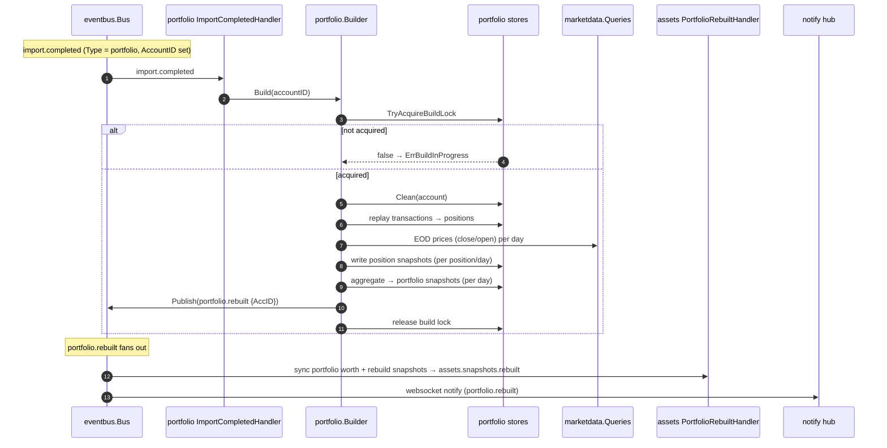

# [013]–[015],[032] Portfolio

> **Feature IDs:** 013 (async rebuild) · 014 (read APIs) · 015 (manual transactions) · 032 (date changes) · **Area:** Core (user-facing) · **Status:** live; routes registered in `cmd/ta11y/main.go`
>
> **Backend packages:** `internal/portfolio` · `transport/http/handlers/portfolio` · `transport/messaging/handlers/portfolio` · `internal/storage/sqlx_portfolio_store.go`
>
> **Related features:** [002] CSV imports · [003] Account management · [005] Market data · [024] Assets · [001] Realtime updates

## Overview

Portfolio computes and serves investment-account performance from a transaction stream plus
market data:

- **[014] Reads** — account snapshot time series (`GET /portfolio/snapshots`), current/closed
  positions with their latest snapshot metrics (`GET /portfolio/positions`), and filtered
  transaction history (`GET /portfolio/transactions`).
- **[015] Manual writes** — create one manual transaction (BUY/SELL/DIVIDEND/TAX/FEE/CASH) on
  any day up to and including today, and later edit or delete it. Manual rows are
  `origin = MANUAL` and carry no import; imported rows can be neither edited nor deleted.
- **[032] Change date** — move one manually entered transaction to another day, today or
  earlier. Nothing else about it changes, and imported rows are refused.
- **[013] Async rebuild** — a full rebuild recomputes positions → position snapshots →
  account snapshots. It is triggered asynchronously over the event bus when a portfolio CSV
  import completes, synchronously via `POST /portfolio/rebuild`, and in the background after a
  manual write.

## Domain model

Enums: `TransactionType` ∈ {BUY, SELL, DIVIDEND, TAX, FEE, CASH}; `TransactionOrigin` ∈
{IMPORT, MANUAL}. A position is open while `CloseDate` is nil.

## Data model

Key constraints: `ck_portfolio_transactions_import_origin` enforces `IMPORT ⇒ import_id NOT NULL`
and `MANUAL ⇒ import_id NULL`; `checksum` is unique; position snapshots are unique per
`(position_id, occurred_at)` and account snapshots per `(account_id, occurred_at)`. Physical
names: Postgres `portfolio.*`; SQLite `portfolio_accounts` / `portfolio_transactions` /
`positions` / `position_snapshots` / `portfolio_snapshots`.

## Lifecycles

**Account rebuild lock** (`portfolio.accounts.building`):

**Position** (`positions.close_date`):

## Async rebuild flow

`POST /portfolio/rebuild` runs `Builder.Build` **inline** and returns `204` only when the full
rebuild finishes. The decoupled path is import-driven:

## Endpoints

| Feature | Method + route | Key inputs | Success |
| --- | --- | --- | --- |
The account comes from the session on every route ([030]); no request carries an `account_id`.

| Feature | Method + route | Key inputs | Success |
| --- | --- | --- | --- |
| [014] Snapshots | `GET /portfolio/snapshots` | query: `from`, `to` | 200 `[{occurred_at, market_value, total_pnl, ...}]` |
| [014] Positions | `GET /portfolio/positions` | query: `include_closed` | 200 `{include_closed, data[]}` |
| [014] Transactions | `GET /portfolio/transactions` | query: `from/to`, `limit/offset`, `sort_by/sort_order`, `q`, `type`, `origin`, `source`, `listing` | 200 `{pagination, data[]}` |
| [013] Rebuild | `POST /portfolio/rebuild` | empty body | **204** (synchronous) |
| [015] Manual create | `POST /portfolio/transactions/manual` | body: `vendor_id`, `occurred_at`, `type`, `listing_id?`, `amount`, `quantity?`, `description?` | 201 transaction + `rebuild` |
| [032] Change date | `POST /portfolio/transactions/date` | body: `id`, `occurred_at` | 200 `{id, occurred_at, rebuild}` |
| [015] Manual edit | `PUT /portfolio/transactions/{transaction_id}` | body as create, without `vendor_id` | 200 transaction + `rebuild` |
| [015] Manual delete | `DELETE /portfolio/transactions/{transaction_id}` | — | 200 `{id, rebuild}` |

**Error mapping (highlights):** validation and a date after today → 400; `account.ErrAccountNotFound`
and an unknown transaction id → 404; rebuild `ErrBuildInProgress` → 409, `ErrPortfolioNoSnapshots`
→ 422; manual create maps the `ErrManual*` family to 400/404/422 and duplicate → 409; changing the
date of, editing or deleting an imported row → 422; else 500.

`rebuild` on the manual writes is `started` (scheduled in the background, followed by a
`portfolio.rebuilt` websocket event when done) or `skipped` (nothing scheduled). The write itself
succeeded in either case.

## Processing rules

- **Rebuild pipeline (`Builder.Build`).** Acquire the build lock (else `ErrBuildInProgress`);
  `Clean` prior positions/snapshots; replay the account's transactions in date order into
  positions (one cycle per canonical instrument key — ISIN preferred, else symbol, with
  symbol→ISIN alias promotion); for each position walk day-by-day pricing via EOD
  close→open→carry-forward→transaction-price fallback and persist one position snapshot per
  day; aggregate into one account `PortfolioSnapshot` per day (net / cumulative cashflow,
  time-weighted return) from each position's most recent snapshot on or before that day, so a
  closed position keeps contributing its realized result, income and costs at zero market
  value (`aggregatePortfolioSnapshots`). Everything after the lock runs in one database
  transaction (`PortfolioStore.Do`) and snapshots are written in multi-row inserts of 500, so
  readers keep the previous result until the rebuild commits and a failed one leaves it in
  place. Zero position snapshots ⇒ the cleared state is committed and `ErrPortfolioNoSnapshots`
  returned. The lock is taken outside the transaction and always released (fresh background
  context) even on cancellation.
- **Listing linking runs on every rebuild**, so a listing added after an import links the
  transactions that were already there. The match is `marketdata.Queries.ListingByIdentity`:
  the exact ISIN, or the exact symbol when the instrument has no ISIN. A present-but-unknown
  ISIN does not fall back to the symbol, and no match leaves `listing_id` null rather than
  attaching the position to a near neighbour — an unlinked position is still built, it simply
  produces no snapshots and therefore no market value. The split replay resolves listings the
  same way.
- **Import deduplication is content-based.** The unique row `checksum` covers what the row is
  plus the dedup sequence the importer stamps ([032]); the CSV line number is stored and orders
  same-day rows but is no longer part of the checksum, so a partly overlapping export is
  recognised instead of imported twice.
- **Manual create** persists `origin = MANUAL`, `import_id = NULL`, `position_id = NULL`;
  CASH encodes direction in the `Quantity` sign and stores an absolute amount; BUY/SELL derive
  `unit_price = amount / quantity`. `occurred_at` must be today or earlier. It emits no event
  of its own, but asks for a rebuild once the row is stored.
- **Moving a transaction ([032]).** Only `origin = MANUAL` rows can be moved, and only to today
  or earlier. The checksum carries the date, so it is recomputed for the new day and looked up
  within the account first; a hit that is not the row itself is refused rather than written.
  The recomputation deliberately leaves `position_id` out: a rebuild writes it onto the row long
  after the checksum was generated, so the identity to stay comparable with is the one the row
  was created under. Imported rows keep their statement date — moving one would change the
  identity the next import of the same file compares against, so it would insert the old row
  again. A move is followed by a rebuild, because the row lands elsewhere in the stream.
- **Editing and deleting ([015]).** Only `origin = MANUAL` rows, under the create rules
  (`manualTransactionData` is shared). An edit keeps the row's id, vendor and origin, recomputes
  the checksum from the edited content (a clash with another row is refused as a duplicate) and
  clears `position_id` for the rebuild that follows to set again. Imported rows are refused for
  both: they stay as the statement records them, and a deleted one would return on re-upload.
- **Rebuilding after a manual write.** The write answers straight away and leaves the rebuild
  to a per-process queue (`rebuild_queue.go`) on a context detached from the request. It runs
  at most one rebuild per account and folds requests that arrive meanwhile into one follow-up
  run, so the last rebuild starts after the last write. A rebuild started elsewhere (an
  import, `POST /portfolio/rebuild`) holding the lock is waited out and retried every second,
  within a 30-minute bound. A failed background rebuild is logged; the client learns of a
  finished one through `portfolio.rebuilt`.
- **Reads.** Snapshots are ordered `occurred_at ASC` (optionally date-bounded); positions join
  their latest snapshot and can include closed positions; transactions support filter + sort
  (`date` only) + offset pagination (limit ∈ {10,25,50,100}, default 25). A transaction without
  a symbol reports the symbol of the listing its position is linked to, and `q` / `listing`
  match it, so ISIN-only imported rows read and search by ticker. Positions take that symbol
  during the rebuild's listing link.

## Events

| Topic | Constant | Payload | Direction | Notes |
| --- | --- | --- | --- | --- |
| `portfolio.rebuilt` | `portfolio.TopicRebuilt` | `Rebuilt{AccID}` | published | after a successful `Build`; consumed by assets sync + notify |
| `account.created` | `account.TopicCreated` | `Created{AccID}` | consumed | `AccountCreatedHandler` → `CreateAccount` (projection + lock row) |
| `import.completed` | `importer.TopicCompleted` | `Completed{ImportID, Type, AccountID}` | consumed | `ImportCompletedHandler` rebuilds only when `Type = portfolio` and `AccountID` set |

There is **no** rebuild-*request* event; the only async rebuild trigger is `import.completed`.

## Code map

| Path | Responsibility |
| --- | --- |
| `internal/portfolio/commands.go` | Manual create/edit/delete, projection create, bulk import insert + `CommandStore`, change date |
| `internal/portfolio/queries.go` | Snapshot/position reads, `UnlinkedProducts` for one import + `QueryStore` |
| `internal/portfolio/builder.go` | Rebuild engine + `PositionStore`/`PortfolioStore`/`TransactionStore`/`Locker`; publishes `portfolio.rebuilt` |
| `internal/portfolio/transaction.go` · `position.go` · `portfolio.go` · `account.go` | Domain types, position math, snapshots, projection + build errors |
| `internal/portfolio/events.go` | `TopicRebuilt` + `Rebuilt` |
| `transport/http/handlers/portfolio/{snapshots,positions,transactions,rebuild}.go` | Read, rebuild, manual-create and change-date handlers |
| `transport/http/handlers/portfolio/transaction_{update,delete}.go` | Manual edit and delete handlers |
| `transport/messaging/handlers/portfolio/{account_created,import_completed}.go` | Projection + rebuild-on-import subscribers |
| `internal/storage/sqlx_portfolio_store.go` | `SQLXPortfolioStore` implementing all six portfolio interfaces |

## Gaps / not implemented

- `PortfolioSnapshot.CashBalance` is always built as 0 (cash positions are excluded from market
  value); EOD-import-driven revaluation is intentionally not wired.
- **Imported rows are fixed.** They can be neither edited nor deleted; a wrong statement line
  is corrected at the source or offset with a manual transaction.
- **The vendor of a manual transaction cannot be changed** after it is entered.
- **A failed background rebuild is only logged.** No event announces it, so the page keeps saying
  the portfolio is being updated; `POST /portfolio/rebuild` is the way out. The queue lives in
  the process, so a rebuild pending at shutdown is dropped (the transaction rolls back and the
  previous result stays) until the next write or rebuild.
- **Every rebuild is a full rebuild** from the first transaction, not from the edited date.
